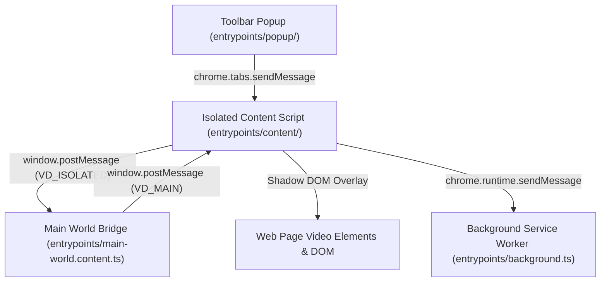

# Reusable Components & Architecture

This module details how UI components, shared utilities, and state stores must be structured for maximum modularity and isolation.

---

## 1. Multi-World Context Architecture

The extension executes across three distinct contexts. Always keep code separated by role:



1. **MAIN World (`entrypoints/main-world.content.ts`)**:
   - Executes inside the page context.
   - Responsible for fetching authenticated video streams and assembling chunks.
   - Triggers native file downloads via `<a download>`.
2. **ISOLATED World (`entrypoints/content/index.tsx`)**:
   - Detects `<video>` elements via `MutationObserver`.
   - Mounts React overlays into open Shadow Roots.
   - Listens to messages from the Popup and relays tasks to the MAIN world.
3. **Popup (`entrypoints/popup/`)**:
   - Quick toolbar UI to inspect detected tab videos and control ongoing downloads.

---

## 2. Shadow DOM Component Encapsulation

Target websites (like Telegram Web) use complex CSS resets that will break standard injected HTML.

* **Mandatory Pattern:** Always create a Shadow Root for in-page UI:
  ```tsx
  const host = document.createElement('div');
  const shadowRoot = host.attachShadow({ mode: 'open' });
  const styleEl = document.createElement('style');
  styleEl.textContent = inlineCss; // import css from './style.css?inline';
  shadowRoot.appendChild(styleEl);

  const mountPoint = document.createElement('div');
  shadowRoot.appendChild(mountPoint);
  const root = ReactDOM.createRoot(mountPoint);
  root.render(<MyComponent />);
  ```
* **Benefits:** 
  - Host page CSS cannot bleed into the extension buttons/modals.
  - Extension CSS cannot break host page layouts.

---

## 3. Shared Utilities Ecosystem

Before writing new utility code, check and reuse functions from [utils/downloader.ts](../utils/downloader.ts):

| Function | Purpose |
| :--- | :--- |
| `formatBytes(bytes)` | Converts raw byte counts into human-readable strings (`14.2 MB`, `1.2 GB`). |
| `formatSpeed(bytesPerSec)` | Formats real-time download speeds (`4.5 MB/s`, `720 KB/s`). |
| `getVideoResolutionLabel(video)` | Inspects video elements and returns standard labels (`1080p`, `720p`, `4K`). |
| `generateFriendlyVideoName(url, index)` | Produces clean, readable titles instead of raw blob UUIDs. |
| `generateVideoFilename(url, extension, index)` | Generates clean, timestamped filenames safe for filesystem saving. |
| `cleanDisplayTitle(rawTitle, url)` | Strips raw blob/http URLs and returns friendly display labels. |

---

## 4. Centralized In-Memory Store (`stores/downloadStore.ts`)

* Manages active tasks, completion states, speeds, and progress percentages.
* Provides a simple pub/sub pattern (`subscribe(listener)`).
* Keeps state lightweight and decoupled from persistent disk storage, avoiding unnecessary permission requirements.
