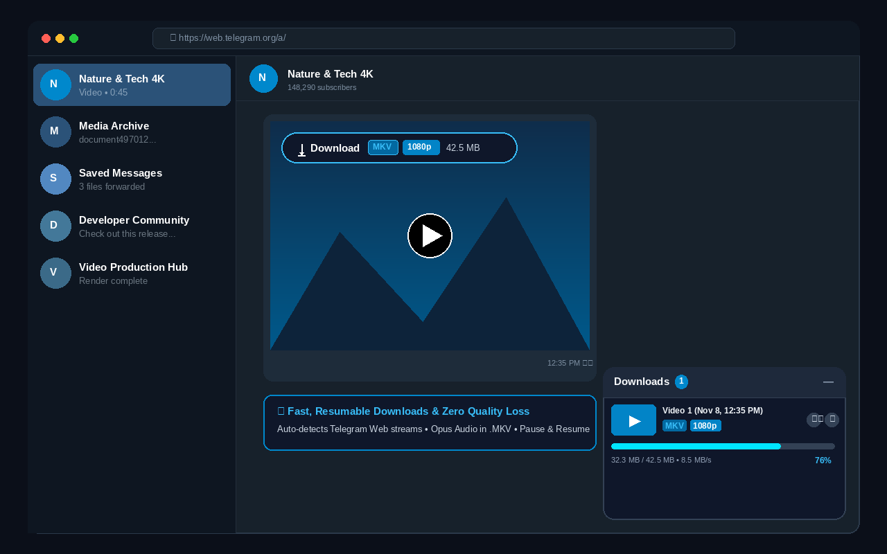

# 🎥 Video Downloader (Web & Telegram)

A modern, high-performance Manifest V3 browser extension built with **WXT**, **React 18**, and **TypeScript**. It automatically detects progressive video streams and blobs on web pages (specifically optimized for **Telegram Web**) and renders an isolated floating download button directly over the video with real-time download progress tracking.

<p align="center">
  
</p>

---

## ✨ Features

- **🚀 Telegram Web Optimized**:
  - Automatically hooks into dynamic Telegram Web video containers (`.full-media`, `video`, full-screen media viewer).
  - Intercepts authenticated progressive endpoints (`https://web.telegram.org/a/progressive/document...`) via in-page Service Worker integration.
  - Supports `blob:` URLs, MP4, WebM, and progressive streams.
- **⚡ High-Speed Resumable Downloads**:
  - Continuous stream reading with zero-copy ArrayBuffer processing.
  - Fully resumable from the exact byte offset if paused, interrupted, or restarted.
  - Infinite auto-retry and connection recovery on network drops.
- **🎵 Crystal-Clear Audio Preservation**:
  - Automatically multiplexes Telegram Matroska streams into `.mkv` files with Opus audio decoding intact.
- **🛡️ 100% Shadow DOM Style Isolation**:
  - The React overlay button and dock are mounted inside scoped Shadow Roots (`attachShadow`). Telegram's styles will never break the buttons, and the extension's styles will never break websites.
- **🎛️ Dual Access (Overlay & Floating Dock & Popup)**:
  - **Inline Video Tag**: Floats directly over videos showing format (`MKV`, `MP4`), resolution (`1080p`, `720p`), exact file size, and live speed.
  - **Floating Dock**: Persistent bottom-right corner manager with 16:9 video preview thumbnails, live speed gauges, inline file renaming, and pause/resume/delete controls.
  - **Toolbar Popup**: Extension popup listing all page-detected videos and active download tasks.
- **🏷️ Clean Naming**:
  - Automatically generates friendly video titles (e.g. `Video 1 (Nov 8, 12:35 PM)` or `Telegram Video 5516`) instead of raw blob UUIDs.
  - One-click inline renaming with auto-extension preservation.
- **🗑️ Safe Cancellation**:
  - Cancelling immediately aborts the active stream, purges memory buffers, and strictly prevents partial or corrupt files from saving to disk.

---

## 📂 Project Structure

```
VideoDownloader/
├── entrypoints/
│   ├── background.ts          # Background service worker (badge counts, fallback downloads)
│   ├── content/               # Content script with Shadow DOM React injection
│   │   ├── DownloadOverlay.tsx # Floating React overlay with progress bar
│   │   ├── index.tsx          # MutationObserver detecting dynamic SPA videos
│   │   └── overlay.css        # Scoped CSS injected into the Shadow DOM
│   └── popup/                 # Extension toolbar popup UI
│       ├── App.tsx            # Popup React component
│       ├── index.html         # Popup entry HTML
│       ├── main.tsx           # Popup React root
│       └── style.css          # Dark-mode styling for popup
├── public/
│   └── icon/                  # Extension icons (16, 48, 128px)
├── utils/
│   └── downloader.ts          # In-page fetch engine, stream reader, and filename parser
├── package.json
├── tsconfig.json
└── wxt.config.ts              # Manifest V3 & WXT configuration
```

---

## 🛠️ Installation & Development

### 1. Install Dependencies
Run the following in the project root:
```bash
npm install
```

### 2. Start Live Development (Hot Reload)
```bash
npm run dev
```
WXT will start Vite and automatically launch a clean Chrome profile with the extension preloaded.

### 3. Build for Production
```bash
npm run build
```
The compiled extension will be output to `.output/chrome-mv3`.

---

## 📥 Loading into Chrome / Brave / Edge Manually

1. Open your browser and navigate to `chrome://extensions`.
2. Enable the **Developer mode** toggle in the top-right corner.
3. Click the **Load unpacked** button in the top-left corner.
4. Select the `.output/chrome-mv3` folder inside this project directory.
5. Open [Telegram Web](https://web.telegram.org/) or any video site and start watching or scrolling videos!

